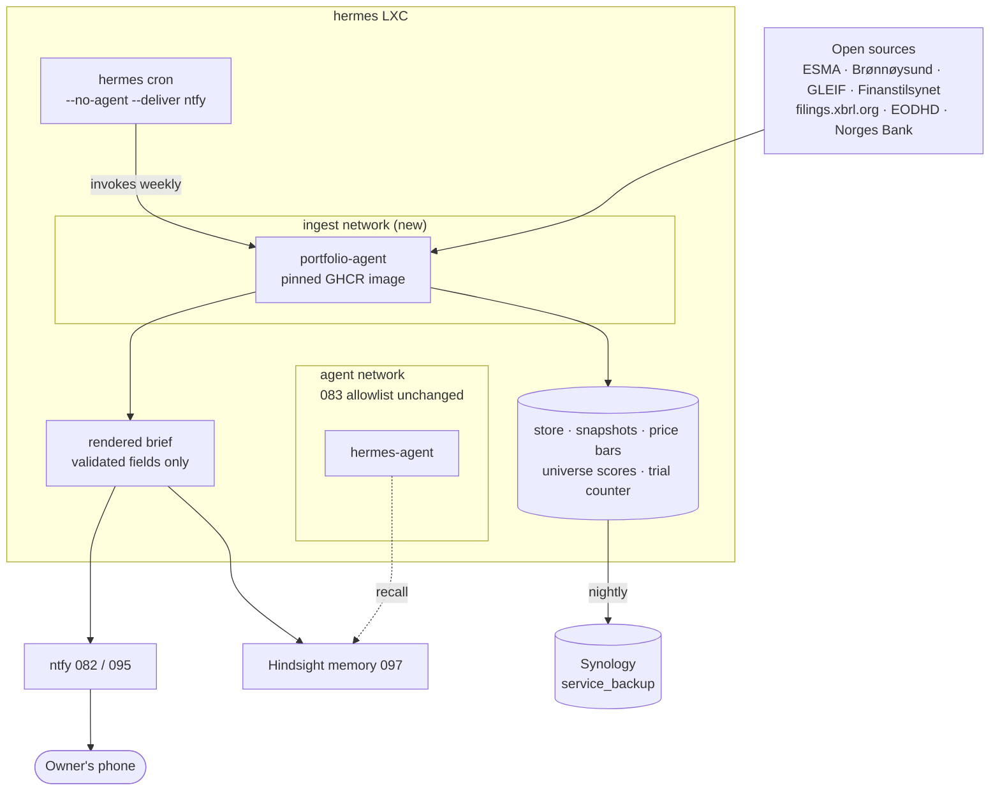

# Feature Specification: Portfolio Agent — a weekly risk brief as a Hermes cron job

**Feature Branch**: `098-portfolio-agent-deploy`
**Created**: 2026-10-31
**Revised**: 2026-11-01, after the application repository's data-source spike
([`portfolio-agent` 001 decision](https://github.com/lightenup/portfolio-agent/blob/main/docs/backlog/001-spike/decision.md)).
That spike found no open source for announcements (until ESAP opens, by July 2027) or historical
prices, and the owner redesigned the application around open registry data: **weekly, no model, no
gateway, no backtest**. Placement, coupling, code location, ingest host and memory write are
unchanged. What changed is recorded under [Revision 2026-11-01](#revision-2026-11-01).
**Status**: Draft, **ready for `/speckit-specify`**. One new non-blocking question (capital
deployment, Open Question 6) carries into the spec as an assumption. **Hard prerequisite not yet
met**: the application repository has not shipped its first GHCR image, as `market-model` had to
before [`048`](./048-market-model-deploy.md) could proceed. Depends on
[`083`](./083-hermes-agent-runtime.md) (cron, ntfy, egress),
[`082`](./082-ntfy-push-service.md)/[`095`](./095-ntfy-two-way.md) (delivery and approval),
[`097`](./097-hermes-long-term-memory.md) (shared memory). No longer depends on
[`064`](./064-llm-router.md) in v1.
**Input**: Give the owner a weekly brief on an Aksjesparekonto (ASK) at Nordnet that flags holdings
under structural threat and refuses trades that cannot pay for their own commission. Deliver it to
the phone before the exchange opens on the first trading day of the week. This is the **deploy and
integration side only**; the ingest, scoring and validation code lives in
[`portfolio-agent`](https://github.com/lightenup/portfolio-agent) and ships as a pinned GHCR image,
as `market-model` ([`048`](./048-market-model-deploy.md)) and `financial-scenario`
([`046`](./046-financial-scenario-deploy.md)) do.

---

## Why this exists

The owner holds a Nordnet ASK with roughly 60,000 NOK across seven equity positions and one index
fund, and adds 1,200 NOK a month. Three facts about that account make the usual "trading assistant"
shape wrong, and they are the reason this item exists at all.

1. **The cost floor forbids frequent trading.** Nordnet Mini charges 0.15 % with a **29 NOK
   minimum** on Nordic trades; the percentage only overtakes the minimum above **19,333 NOK**.
   On a 6,000 NOK position a round trip costs about 1 %. Outside the Nordics it is 0.20 % with a
   49 NOK minimum plus 0.25 % currency conversion each way — about 2 %. Any system that proposes
   trades often destroys the account arithmetically, whatever its hit rate.
2. **The owner does not want trade ideas.** The stated objective is process over P&L: catch
   positions under long-term structural threat, deploy new capital without thinking about it, and
   keep an auditable record. Market timing is explicitly rejected.
3. **Nothing here needs a new service.** [`083`](./083-hermes-agent-runtime.md) already delivers
   exactly the runtime this needs: `hermes cron create "<schedule>" --no-agent --script <file>
   --deliver ntfy`, with the model scout at `"30 7 * * *"` as the working precedent. ntfy gives
   push; [`095`](./095-ntfy-two-way.md) gives interactive approval with a 15-minute timeout.
   Constitution IV ("consolidate before adding", "when in doubt, ship less") rules out a new LXC
   for a job that runs once a week.

So this is not a trading service. It is **one scheduled script, one pinned container, and a brief
that usually says nothing to do** — which at this account size is the correct answer most weeks.

### What the evidence supports, and what the data allows

The research behind the signal choice is recorded in the design document
(`Hermes Trading Agent — Design Spec`, 2026-10-30), and the data available for it in the
application's 001 spike. Together they bind this spec:

- **Net equity issuance predicts poor returns**, internationally and most strongly in small caps,
  where it is the dominant driver of high asset growth and the effect persists about two years. The
  application reads it from open registers rather than announcements: Brønnøysund share-count
  changes (classified so a split is not read as dilution), listed subscription rights in ESMA FIRDS,
  and equity prospectuses in ESMA's prospectus register.
- **Liquidity decay** comes from ESMA's yearly transparency calculations (FITRS) and, forward-only,
  from daily prices.
- **Other open signals**: Finanstilsynet's public short positions, Brønnøysund distress flags and
  auditor or CEO changes, and accounting distress from ESEF annual reports.
- **Disclosed insider trades carry no reliable edge** on the Oslo main list (Eckbo & Smith; Eckbo &
  Ødegaard; a BI study of 1,628 trades 2011–2015). They are not used.
- **LLMs cannot be trusted with the arithmetic** (Backtrader-Bench). In v1 the question does not
  arise: every input is structured, and no model is called.

Honest walk-forward validation of textbook strategies lands near Sharpe 0.33–0.36. No open source
supplies historical Oslo prices, so no returns backtest runs at all; the application instead runs
one pre-registered check of whether its historical signals ranked later failures higher, and labels
every score "unvalidated" until that check passes.

## Revision 2026-11-01

| was | now | why |
|---|---|---|
| Daily brief before 09:00 | **Weekly**, before the first open of the week | Owner decision. The open inputs change yearly to weekly; daily would mostly say nothing. Revisit when an announcement source exists. |
| Announcements from NewsWeb, parsed by a model | **No announcements in v1** | Euronext's terms forbid robots and systematic databases on NewsWeb. ESAP is the open route, from July 2027, and will be a new application item. |
| Prices from yfinance | **EODHD free plan**, forward-only from November 2025 | Yahoo's terms forbid automated collection. EODHD's free plan permits personal storage and analysis, with a one-year window and 20 calls a day. Raw price series must not be redistributed. |
| Model extraction through the gateway, own `064` client | **No model, no gateway client** | Nothing to extract. FR-005, FR-010, FR-012 and SC-003 are withdrawn until the ESAP item. |
| Backtest harness with deflated Sharpe gates | **Pre-registered historical classifier check** | No historical prices. Outcome is delisting with issuer failure, independent of price. |
| Holding: ticker, venue, currency, quantity, cost basis | **Holding: ISIN, flagged share or fund** | Owner decision: no values or quantities stored. |
| Application repository name open | **`portfolio-agent`** | Exists. Its brief item is `005` (it was `006` before the application backlog was renumbered). |
| Data sourcing preference | **Open and free only** (application constitution 1.2.0+) | Owner decision after the spike: no paid sources, no permission requests. |

## Decisions recorded (2026-10-31, revised 2026-11-01)

| decision | choice | why |
|---|---|---|
| What the agent optimises for | **Process over P&L** | Owner choice. Measured by decision quality and rubric calibration, not returns. |
| Placement | **A Hermes `--no-agent` cron job**, not a new LXC | `083` delivers cron + ntfy as configuration. Constitution IV. A once-weekly job does not justify a service, its backup role, its monitoring contract or an IP. |
| Application code | **`portfolio-agent`, pinned GHCR image** | Mirrors `market-model` `048` and PFS `046`. Keeps this repo config-only and lets the algorithm have its own spec-kit project and test suite. |
| Coupling to `market-model` / `financial-scenario` | **None in v1** | Owner choice. The orchestrator slot `048` names stays empty; revisit once this earns its keep. |
| Ingest host | **The Hermes LXC** (2026-10-31) | Owner decision: Hermes will carry out internet ingest for other work regardless, so a second fetcher on that LXC is not a new category of exposure. Rejected: a separate LXC (Constitution IV). |
| Egress boundary | **A separate compose service on its own network**, not the `agent` network | Keeps the agent's rendered allowlist stable and makes the ingest's own reachable set explicit and reviewable in one place (FR-004). |
| Brief into shared memory | **Yes, written to Hindsight** (2026-10-31) | Owner decision: LAN-only, single user. Carries the `097` injection caveat and the `097` FR-012 Claude Code risk (see Accepted risks). |
| Execution of trades | **Always manual** | Nordnet's external API is not onboarding new customers. At 2–4 trades a year automation saves nothing and adds a class of failure that costs real money. |
| Index fund role | **Absorber, never timer** | Fund trades carry no commission, so deposits and sale proceeds land there at zero cost. The owner rejects market timing. |
| Cadence (2026-11-01) | **Weekly** | See Revision. |
| Signal basis (2026-11-01) | **Issuance, liquidity, short interest, registry distress, governance, accounts; price signals forward-only** | The signals with an open, automatable source (application 001 addendum). |
| Model role (2026-11-01) | **None in v1** | Every input is structured. A model returns with the ESAP item, under the original constraints (extraction only, constrained decoding, verbatim spans). |
| Validation (2026-11-01) | **Pre-registered historical check before any score loses its "unvalidated" label** | No price history, so no backtest. Gates live in application item `004`. |
| Brief rendering | **From validated structured fields, never model prose** | The ingest reads untrusted web content; free text would carry injection to the phone (FR-011). |

### Accepted risk: the ingest reads untrusted content

Register responses and price payloads are untrusted input. With no model in v1, a poisoned payload
can at worst produce a wrong *field value* (a name, a number, a flag), never an instruction: the
ingest has no tools, no shell and no inference path, and the brief is assembled from validated
fields (FR-011). To be re-assessed when the ESAP item reintroduces model extraction.

### Accepted risk: briefs in shared memory reach Anthropic through Claude Code

Writing the brief to Hindsight (FR-021) puts portfolio content into the store that
[`097`](./097-hermes-long-term-memory.md) shares across Hermes, Open WebUI and Claude Code. The
store itself is LAN-only and single-user, but `097` FR-012 records that Claude Code runs on
Anthropic's models under an EY enterprise seat, so anything it recalls is sent there as prompt
content. Holdings and threat flags are therefore in scope of that existing accepted risk, not exempt
from it. Bounded by the same controls `097` already specifies.

**Decided 2026-10-31**: portfolio memories carry no extra restriction — they are ordinary memories
and the existing `097` FR-012 bound is accepted as written. The lever (a tag-scoped read restriction
on the Claude Code key) remains available if the risk assessment changes. Raw price series and
natural persons' names never enter the store (FR-021), which keeps EODHD's redistribution terms and
the short register's holder names out of that path.

## Proposed architecture

One scheduled script, one pinned container, no new service. Everything outside the `hermes` LXC
already exists.

The ingest reaches the internet but never the agent's network or the gateway, and the brief leaves
by two independent paths — ntfy for delivery, Hindsight for recall — so a failure in either does not
block the other.

---

## User Scenarios & Testing *(mandatory)*

### User Story 1 - The brief says nothing to do, and that is correct (Priority: P1)

**Independent Test**: Run the job in a quiet week. The phone gets one ntfy message before the first
open of the week stating that no holding changed threat band and no trade clears the cost hurdle.
The message is under a screenful and names the next scheduled run.

**Acceptance Scenarios**:
1. **Given** no register change for any holding, **When** the job runs, **Then** one brief arrives
   saying nothing to do, with the date and the holdings and sources it checked.
2. **Given** the job has nothing to say for ten consecutive weeks, **When** the eleventh runs,
   **Then** it still delivers — silence is never used to mean "nothing happened", because silence
   is indistinguishable from a failed job.
3. **Given** the brief is delivered, **When** the owner reads it, **Then** every number in it was
   computed in Python and is reproducible from the run's stored inputs.

### User Story 2 - A holding under structural threat is flagged before it matters (Priority: P1)

**Independent Test**: Replay the stored register history of a company that diluted heavily. The
rubric raises its threat band on the issuance, and the brief names the company, the register and
value behind the flag, and the computed dilution percentage.

**Acceptance Scenarios**:
1. **Given** a share-count increase the application classifies as an issue for a held company,
   **When** the job runs, **Then** the brief flags it and states the dilution as a percentage of the
   previous share count.
2. **Given** a share-count change that is not dilutive (a split, a reverse split, a bonus issue),
   **When** classified, **Then** it does not raise the threat band.
3. **Given** a source that did not answer, **When** the brief is rendered, **Then** it names the
   source and what could not be checked, rather than reporting the holding as quiet.

### User Story 3 - A trade that cannot pay for itself is refused (Priority: P1)

**Independent Test**: Ask for a 3,000 NOK purchase. The cost governor refuses it, names the modelled
round-trip cost as a percentage, and states the minimum viable size. Ask for 18,000 NOK in a name
that clears the entry bar: it is proposed, with the cost stated before the rationale.

**Acceptance Scenarios**:
1. **Given** a proposed position under the minimum viable size, **When** the governor runs,
   **Then** it is refused and the refusal names the number that caused it.
2. **Given** a foreign-listed candidate, **When** costed, **Then** the estimate includes both legs
   of the currency conversion, not only commission.
3. **Given** the owner overrides a refusal, **When** the override is taken, **Then** it is recorded
   in the journal with its reason and appears in the next brief as an open override.

### User Story 4 - Every decision is auditable after the fact (Priority: P2)

**Independent Test**: Six months after a flag, ask what the agent knew on the day. The journal
returns the rubric score, its decomposition, the register observations behind it, the cost estimate
and the rejected alternative — none of it rewritten since.

**Acceptance Scenarios**:
1. **Given** any past brief, **When** retrieved, **Then** its inputs and its reasoning are stored
   as they stood, append-only.
2. **Given** a rubric change, **When** it is applied, **Then** past entries keep the scores they
   were given, and the change is dated.

### User Story 5 - The rubric is scored against the whole market, not only the holdings (Priority: P2)

**Independent Test**: A quarterly run scores every ASK-eligible share in the Oslo universe, writing
scores and no trades. Twelve months later a report measures whether high threat scores preceded
issuer failure.

**Acceptance Scenarios**:
1. **Given** a quarterly scoring run, **When** it completes, **Then** scores for the full universe
   are stored with their as-of date and no trade is proposed from them.
2. **Given** a scoring set twelve months old, **When** the outcome report runs, **Then** it reports
   discrimination against the price-free failure outcome the application defines.

### Edge Cases

- **A source changes or disappears**: an empty response is indistinguishable from a quiet week. A
  source that returns nothing when it historically returned data MUST alert. Brønnøysund describes
  its accounts API as temporary; its loss is reported every run until the application changes.
- **The EODHD free plan changes**: a tighter quota or a removed exchange fails the price adapter
  loudly. Stored prices stay; price signals become missing, not zero.
- **Rate limits**: 20 EODHD calls a day bound the weekly run. The application's rotation (holdings
  first) must fit inside one run's share of the quota, or the job runs a small daily fetch with the
  weekly brief (Open Question 5).
- **Corporate action misread**: a split or reverse split changes the share count without diluting
  anyone, and must not read as issuance or buyback.
- **Position below minimum viable size**: a holding whose exit cost exceeds a threshold percentage is
  reported as a stub, not re-evaluated every run.
- **Hermes LAB rehearsal**: the lab copy has no internet. The job MUST be absent or inert in lab, as
  `067` requires, and its absence must not fail the Hermes LAB check.
- **Job overruns its window**: the run must finish before the first open of the week or deliver a
  partial brief that says so.
- **Two runs overlap**: a manual `hermes cron run` during the scheduled run must not corrupt state.

## Requirements *(mandatory)*

### Functional Requirements

- **FR-001**: The job MUST be installed as a Hermes `--no-agent` cron job
  (`hermes cron create "<schedule>" --no-agent --script <file> --deliver ntfy`), following the model
  scout precedent in `083`, on a **weekly** schedule. No new LXC, no new Terraform service, no new
  monitoring contract target, no new IP.
- **FR-002**: The ingest, scoring and brief-rendering code MUST ship as a **pinned, non-`latest`
  GHCR image** built in `portfolio-agent`. This repo pulls and runs it; it never builds from source
  on the LXC and never installs Python dependencies at runtime.
- **FR-003**: The cron script MUST be thin: invoke the pinned image, collect its exit status and
  rendered brief, hand the brief to ntfy. All logic lives in the image.
- **FR-004**: The ingest container MUST run as its own compose service on its **own network**, not
  on the `agent` network, and the agent's rendered allowlist (`083` FR-008,
  `hermes-agent-egress.sh.j2`) MUST NOT change in the delivering PR. The ingest gets its own rules,
  allowing exactly: `registers.esma.europa.eu`, `data.brreg.no`, `api.gleif.org`,
  `ssr.finanstilsynet.no`, `filings.xbrl.org`, `eodhd.com`, `data.norges-bank.no`, and `ghcr.io`
  for the image pull. The rest of the LAN, the tailnet and link-local stay blocked. This is
  separation for reviewability, not a trust boundary.
- **FR-005**: *Withdrawn 2026-11-01.* No model calls in v1, so no gateway client. Reinstated with the
  ESAP item, with its own client in `llm_router_clients`, its own `rpm` and budget, and the `064`
  sizing rule re-checked.
- **FR-006**: Every numeric quantity — costs, position sizes, scores — MUST be computed in Python and
  unit-tested.
- **FR-007**: The cost model MUST be a pure, tested function covering: 0.15 % with a 29 NOK minimum
  for Nordic venues, 0.20 % with a 49 NOK minimum outside, 0.25 % currency conversion per leg, and a
  spread estimate for thin names. It is the single source of truth for every cost figure in the
  brief.
- **FR-008**: The cost governor MUST refuse any proposal that would create a position below the
  minimum viable size, or whose modelled round-trip cost exceeds the claimed edge. It MUST NOT be
  overridable except by the owner, with the override logged (US-3).
- **FR-009**: The brief MUST be delivered every scheduled run, including when there is nothing to
  report. A missing brief means a failed job, and MUST alert.
- **FR-010**: *Withdrawn 2026-11-01* (model extraction). Reinstated with the ESAP item.
- **FR-011**: The brief MUST be rendered from validated structured fields. No free model prose
  reaches the phone.
- **FR-012**: *Withdrawn 2026-11-01* (extraction regression set). Reinstated with the ESAP item.
- **FR-013**: Durable state — the store, register snapshots, price bars, universe scores, the
  journal, the trial counter — MUST live on the Hermes LXC's local disk under its own directory
  (sibling to `{{ hermes_data_dir }}/agent`), be append-only for journal entries, and be covered by
  the existing `service_backup` invocation with the `deploy_environment` gate (`067` FR-020 pattern:
  no backup timer in lab). Register snapshots and price bars cannot be refetched once their window
  passes, so they are durable state, not cache.
- **FR-014**: Any score MUST carry an "unvalidated" label until the application's pre-registered
  historical check passes for the signals behind it. The check runs against a survivorship-safe
  universe (from 2018-01-03, via ESMA FIRDS).
- **FR-015**: Every parameter set evaluated MUST increment a persistent trial counter, and that
  counter MUST feed the significance adjustment of the historical check, so that searching harder
  automatically raises the bar for a finding.
- **FR-016**: Monitoring MUST cover: the job ran and exited zero, the brief was delivered, each
  source returned data when it historically did, and ingest errors via the `092` Loki rules.
- **FR-017**: The job MUST be absent or inert in the LAB rehearsal of Hermes, with no internet call
  and no backup timer, and its absence MUST NOT fail the Hermes LAB check (`067`).
- **FR-018**: Secrets (EODHD key, ntfy token, Hindsight credential, GHCR pull credential) MUST come
  from vault into the job's environment at deploy, asserted by preflight with `no_log`, never in git.
- **FR-019**: Trade execution MUST remain manual. The system proposes; the owner places the order.
  No broker credential is stored, and no order-placement path exists in the image.
- **FR-020**: The job MUST be addable to the GitHub Actions workflow dropdowns and service scope
  allowlist in the same PR that introduces it, and MUST be runnable from a developer laptop with the
  same arguments (Constitution V, dual-provisioning parity).
- **FR-021**: The rendered brief MUST be written to the shared memory store (`097`) under the
  portfolio agent's **own client credential** (`097` FR-011), tagged so its origin is distinguishable
  from owner-stated facts (`097` FR-014). Only validated fields are written — never raw source
  responses, never raw price series (EODHD's terms forbid redistribution), never a natural person's
  name. The credential needs write scope only for this tag.
- **FR-022**: Delivery and memory MUST be independent paths. A failed Hindsight write MUST NOT block
  the ntfy brief, and an ntfy outage MUST NOT block the memory write. Either failure is logged
  (`092`) and named in the next successful brief.

### Key Entities

- **Holding**: an ISIN in the ASK, flagged share or fund, with its current threat band. No quantity
  or value is stored (owner decision).
- **Observation**: a register or price value for an issuer or security, with valid time, knowledge
  time and provenance.
- **Threat score**: a rubric result for one company at one as-of date, with its decomposition.
  Written for the full universe quarterly, for holdings on every run.
- **Proposal**: a candidate action with its size, its modelled cost, the bar it cleared or failed,
  and the governor's verdict.
- **Journal entry**: an append-only record of one decision, written before its outcome is known.
- **Brief**: the rendered weekly output, assembled from validated fields, delivered over ntfy.

## Success Criteria *(mandatory)*

- **SC-001**: The brief is delivered before the first open of the week, Europe/Oslo, on every
  scheduled run over an eight-week observation window, with zero missed deliveries not accompanied
  by an alert.
- **SC-002**: On replayed register history, the rubric raises the threat band for every share-count
  change classified as an issue in the set, and for none classified as a split, reverse split or
  bonus issue.
- **SC-003**: *Withdrawn 2026-11-01* (extraction spans). Reinstated with the ESAP item.
- **SC-004**: Zero model-computed numbers in the brief, verified by the absence of any numeric field
  whose provenance is not a Python call.
- **SC-005**: Every score in the brief carries the "unvalidated" label until the application's
  historical check has passed, verified by a test that fails if any rendering path omits it.
- **SC-006**: Zero egress attempts beyond the ingest allowlist during a full run, and zero changes to
  the agent's own allowlist in the delivering PR.
- **SC-007**: Peak memory for the ingest container is within its limit with 30 % headroom, measured
  on a full run including the quarterly universe pass.
- **SC-008**: The Hermes LAB rehearsal passes with the job absent or inert, with the production
  fingerprint unchanged (`067` FR-021) and no backup timer, scrape target or probe created for a
  lab copy.
- **SC-009**: The cost governor refuses 100 % of proposals below the minimum viable size across the
  test set, and every refusal names the number that caused it.
- **SC-010**: After eight weeks of operation, a cadence review reports runs executed, runs that
  produced an action, EODHD calls used against the quota, and wall-clock time per run. The review
  either confirms weekly or proposes a change with those numbers behind it.

## Assumptions

- No inference host is needed in v1. When the ESAP item adds extraction, the Mac remains the only
  inference host and a gateway alias on a dedicated client key is reinstated (FR-005).
- The Hermes LXC has headroom for one more scheduled container and the store it keeps; to be
  measured, not assumed, before `/speckit-plan`.
- The open sources in FR-004 are reachable from the LXC over HTTPS and stay open on their current
  terms. A change is an application adapter decision.
- `hermes cron` jobs survive the restore drill, as `083` FR verifies for existing jobs.
- The owner's account stays on Nordnet Mini; a tier change invalidates FR-007's constants.

## Out of Scope

- Automated order placement, and any broker credential.
- Announcements and model extraction until ESAP (a new application item, and a revision here).
- Intraday signals, derivatives, and anything outside ASK eligibility.
- Coupling to `market-model` or `financial-scenario` (deferred; `048`'s orchestrator slot stays
  empty).
- Tax reporting and anything Skatteetaten-facing.
- Multi-account or multi-owner support.
- Replacing the owner's judgement: the system proposes and refuses, it does not decide.

## Dependencies

- [`083`](./083-hermes-agent-runtime.md): the cron runtime, the `--no-agent` script path, the egress
  allowlist this feature must not widen, the data directory and restore drill.
- [`082`](./082-ntfy-push-service.md) / [`095`](./095-ntfy-two-way.md): delivery, and the approval
  path if an override flow is added later.
- [`092`](./092-log-aggregation.md): log-based alerting for ingest errors.
- [`097`](./097-hermes-long-term-memory.md): the shared memory store, its per-client credential
  extension (FR-011) and its source tagging (FR-014). **This feature cannot ship before `097`
  does** — FR-021 depends on the per-client credential that `097` adds.
- [`067`](../../specs/067-isolated-lab/spec.md): the isolated lab; constrains FR-017 and the backup
  gate in FR-013.
- [`089`](./089-backup-and-log-rotation-quick-fixes.md) / [`091`](./091-backup-coverage-and-staleness.md):
  `service_backup` and staleness alerting for the store and journal.
- [`portfolio-agent`](https://github.com/lightenup/portfolio-agent), which must ship its first GHCR
  image (its item `005`) before this item can be implemented — the hard-prerequisite pattern `048`
  used.
- [`064`](./064-llm-router.md): **not in v1**; returns with the ESAP item.

## Open Questions

1. ~~**Does the ingest belong on the Hermes LXC at all?**~~ **Resolved** 2026-10-31: yes. FR-004
   keeps the two services' reachable sets separately auditable.
2. ~~**Does the brief enter Hermes's long-term memory (`097`)?**~~ **Resolved** 2026-10-31: yes,
   scoped by FR-021 and bounded by the `097` FR-012 Claude Code risk.
3. ~~**Is daily the right cadence?**~~ **Resolved** 2026-11-01: weekly (see Revision), measured by
   SC-010 and revisited when an announcement source exists.
4. ~~**What is the application repository called?**~~ **Resolved** 2026-11-01: `portfolio-agent`, a
   repository with its own constitution and spec-kit project, publishing a pinned GHCR image.
5. **Does the quarterly universe pass, and the daily price rotation, fit the same job?** Without
   inference the quarterly pass is cheap; the open point is EODHD's 20 calls a day, which may need a
   small daily fetch alongside the weekly brief to keep the universe's price window unbroken.
6. **Where does capital deployment live?** This item promises to "deploy new capital without
   thinking about it" (the monthly 1,200 NOK and the fund as absorber), but the application backlog
   after its 2026-11-01 redesign has no item for it. Either the application adds one, or the brief
   states a fixed rule (deposits go to the fund) until it does. Non-blocking: carried as the fixed
   rule.

---

## Notes for `/speckit-specify`

This item is written at backlog depth, not spec depth. No blocking question remains; questions 5
and 6 carry into the spec as recorded assumptions.

Two sequencing constraints the spec must respect, both of the kind `048` handled with a hard
prerequisite line: `portfolio-agent` must ship its first pinned GHCR image, and `097` must land its
per-client credential extension, before FR-002 and FR-021 are implementable.

The design document behind the signal selection and cost arithmetic is `Hermes Trading Agent —
Design Spec` (2026-10-30). The data reality behind the redesign is the application's
[001 decision and addendum](https://github.com/lightenup/portfolio-agent/blob/main/docs/backlog/001-spike/decision.md).
