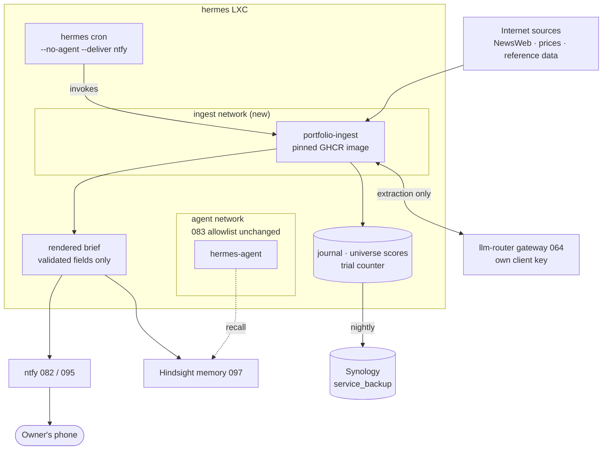

# Feature Specification: Portfolio Agent — a daily risk and deployment brief as a Hermes cron job

**Feature Branch**: `098-portfolio-agent-deploy`
**Created**: 2026-10-31
**Status**: Draft, **ready for `/speckit-specify`** (2026-10-31). Placement, coupling and code
location decided 2026-10-31; the two blocking questions — ingest host and memory write — resolved
the same day (see [Decisions recorded](#decisions-recorded-2026-10-31)). Cadence and Claude Code
read scope also resolved 2026-10-31; two non-blocking questions (application repository name,
quarterly pass placement) carry into the spec as recorded assumptions. **Hard prerequisite not yet met**: the
application repository has not shipped its first GHCR image, as `market-model` had to before
[`048`](./048-market-model-deploy.md) could proceed. Depends on
[`083`](./083-hermes-agent-runtime.md) (cron, ntfy, egress),
[`082`](./082-ntfy-push-service.md)/[`095`](./095-ntfy-two-way.md) (delivery and approval),
[`064`](./064-llm-router.md) (gateway), [`097`](./097-hermes-long-term-memory.md) (shared memory).
**Input**: Give the owner a daily brief on an Aksjesparekonto (ASK) at Nordnet that flags holdings
under structural threat, decides where new capital goes, and refuses trades that cannot pay for
their own commission. Deliver it to the phone before the exchange opens. This is the **deploy and
integration side only**; the ingest, scoring and backtest code lives in its own repository and ships
as a pinned GHCR image, as `market-model` ([`048`](./048-market-model-deploy.md)) and
`financial-scenario` ([`046`](./046-financial-scenario-deploy.md)) do.

---

## Why this exists

The owner holds a Nordnet ASK with roughly 60,000 NOK across seven equity positions and one index
fund, and adds 1,200 NOK a month. Three facts about that account make the usual "trading assistant"
shape wrong, and they are the reason this item exists at all.

1. **The cost floor forbids frequent trading.** Nordnet Mini charges 0.15 % with a **29 NOK
   minimum** on Nordic trades; the percentage only overtakes the minimum above **19,333 NOK**.
   On a 6,000 NOK position a round trip costs about 1 %. Outside the Nordics it is 0.20 % with a
   49 NOK minimum plus 0.25 % currency conversion each way — about 2 %. Any system that proposes
   trades daily destroys the account arithmetically, whatever its hit rate.
2. **The owner does not want trade ideas.** The stated objective is process over P&L: catch
   positions under long-term structural threat, deploy new capital without thinking about it, and
   keep an auditable record. Market timing is explicitly rejected.
3. **Nothing here needs a new service.** [`083`](./083-hermes-agent-runtime.md) already delivers
   exactly the runtime this needs: `hermes cron create "<schedule>" --no-agent --script <file>
   --deliver ntfy`, with the model scout at `"30 7 * * *"` as the working precedent. ntfy gives
   push; [`095`](./095-ntfy-two-way.md) gives interactive approval with a 15-minute timeout.
   Constitution IV ("consolidate before adding", "when in doubt, ship less") rules out a new LXC
   for a job that runs once a day.

So this is not a trading service. It is **one scheduled script, one pinned container, and a brief
that usually says nothing to do** — which at this account size is the correct answer most mornings.

### What the evidence supports, and what it does not

The research behind the signal choice is recorded in full in the design document
(`Hermes Trading Agent — Design Spec`, 2026-10-30). Three results bind this spec:

- **Net equity issuance predicts poor returns**, internationally and most strongly in small caps,
  where it is the dominant driver of high asset growth and the effect persists about two years.
  Oslo Børs publishes share-capital and voting-rights changes as a dedicated regulated announcement
  category, so this signal is a parsing problem, not a scraping project.
- **Disclosed insider trades on the Oslo Børs main list carry no reliable edge** (Eckbo & Smith;
  Eckbo & Ødegaard; a BI study of 1,628 trades 2011–2015 found no significant alphas once converted
  into strategies). The feed is ingested as rubric context only, never as a buy signal.
- **LLMs cannot be trusted with the arithmetic.** Backtrader-Bench found models without tool access
  collapse toward chance on numerical backtest reasoning, with errors concentrating in max drawdown
  and Sharpe — the exact quantities a portfolio brief reports. The model extracts and classifies;
  Python computes.

Honest walk-forward validation of textbook strategies lands near Sharpe 0.33–0.36. This spec treats
a backtest result above ~0.8 as evidence of overfitting rather than discovery (SC-005).

## Decisions recorded (2026-10-31)

| decision | choice | why |
|---|---|---|
| What the agent optimises for | **Process over P&L** | Owner choice. Measured by decision quality and rubric calibration, not returns. |
| Placement | **A Hermes `--no-agent` cron job**, not a new LXC | `083` delivers cron + ntfy as configuration. Constitution IV. A once-daily job does not justify a service, its backup role, its monitoring contract or an IP. |
| Application code | **Its own repository, pinned GHCR image** | Mirrors `market-model` `048` and PFS `046`. Keeps this repo config-only and lets the algorithm have its own spec-kit project and test suite. |
| Coupling to `market-model` / `financial-scenario` | **None in v1** | Owner choice. The orchestrator slot `048` names stays empty; revisit once this earns its keep. |
| Ingest host | **The Hermes LXC** (2026-10-31) | Owner decision: Hermes will carry out internet ingest for other work regardless, so a second fetcher on that LXC is not a new category of exposure. Rejected: a separate LXC (Constitution IV, and it would not reduce what the estate already reaches). |
| Egress boundary | **A separate compose service on its own network**, not the `agent` network | Not a trust boundary claim — `hermes-agent-egress.sh.j2` filters by the agent container's source address on the `agent` network, so a sibling service keeps the agent's rendered allowlist stable and makes the ingest's own reachable set explicit and reviewable in one place. Costs nothing; kept as defence in depth (FR-004). |
| Brief into shared memory | **Yes, written to Hindsight** (2026-10-31) | Owner decision: LAN-only, single user. Lets any `097` client answer questions about past briefs. Carries the `097` injection caveat and the `097` FR-012 Claude Code risk (see Accepted risks). |
| Execution of trades | **Always manual** | Nordnet's external API is not onboarding new customers. At 2–4 trades a year automation saves nothing and adds a class of failure that costs real money. |
| Index fund role | **Absorber, never timer** | Fund trades carry no commission, so deposits and sale proceeds land there at zero cost. The owner rejects market timing, so the zero-cost property is used for routing, not for calls. |
| Signal basis | **Net equity issuance and liquidity decay**, from regulated announcements | The one signal with international evidence that also survives a 1 % cost floor and arrives through a structured feed. |
| Model role | **Extraction and classification only** | Backtrader-Bench. Every number is computed in Python and unit-tested. |
| Model output | **Constrained decoding, evidence before verdict** | Strict JSON mode degrades reasoning when the answer field precedes the reasoning field. Schema order is a free fix. |
| Validation | **Backtest harness before any live use** | Owner choice. Gates in SC-005. |
| Brief rendering | **From validated structured fields, never model prose** | The ingest reads untrusted web content; free text would carry injection to the phone (FR-011). |

### Accepted risk: the ingest reads untrusted content

Announcement text, article bodies and price-page payloads are untrusted input, and the container
that fetches them also reaches the gateway. Three things bound it: the ingest is non-interactive and
has no tools or shell, its model output is schema-constrained with verbatim-span validation
(FR-010), and the brief is assembled from validated fields rather than generated prose (FR-011).
Residual risk is a poisoned *field value* — a company name or a number — not a poisoned instruction.
To be re-assessed if the ingest ever gains tool-calling.

### Accepted risk: briefs in shared memory reach Anthropic through Claude Code

Writing the brief to Hindsight (FR-021) puts portfolio content into the store that
[`097`](./097-hermes-long-term-memory.md) shares across Hermes, Open WebUI and Claude Code. The
store itself is LAN-only and single-user, but `097` FR-012 records that Claude Code runs on
Anthropic's models under an EY enterprise seat, so anything it recalls is sent there as prompt
content. Holdings, position sizes and threat flags are therefore in scope of that existing accepted
risk, not exempt from it. Bounded by the same controls `097` already specifies: Claude Code's own
revocable, optionally read-only credential, and hooks enabled only in private repositories.

**Decided 2026-10-31**: portfolio memories carry no extra restriction — they are ordinary memories
and the existing `097` FR-012 bound is accepted as written. A tag-scoped read restriction on the
Claude Code key was considered and rejected: it would require the `097` operation validator to
filter reads by tag, which that spec does not currently provide, for a store that is LAN-only and
single-user. The lever remains available if the risk assessment changes.

## Proposed architecture

One scheduled script, one pinned container, no new service. Everything outside the `hermes` LXC
already exists.

The two things worth reading off it: the ingest reaches the internet and the gateway but never the
agent's network, and the brief leaves by two independent paths — ntfy for delivery, Hindsight for
recall — so a failure in either does not block the other.

---

## User Scenarios & Testing *(mandatory)*

### User Story 1 - The brief says nothing to do, and that is correct (Priority: P1)

**Independent Test**: Run the job on a quiet market day. The phone gets one ntfy message before
09:00 stating that no holding changed threat band, no deployment is due, and no trade clears the
cost hurdle. The message is under a screenful and names the next scheduled action.

**Acceptance Scenarios**:
1. **Given** no announcement and no deployment trigger, **When** the job runs, **Then** one brief
   arrives saying nothing to do, with the date and the holdings it checked.
2. **Given** the job has nothing to say for ten consecutive days, **When** the eleventh runs,
   **Then** it still delivers — silence is never used to mean "nothing happened", because silence
   is indistinguishable from a failed job.
3. **Given** the brief is delivered, **When** the owner reads it, **Then** every number in it was
   computed in Python and is reproducible from the run's stored inputs.

### User Story 2 - A holding under structural threat is flagged before it matters (Priority: P1)

**Independent Test**: Replay the historical announcement stream for a company that diluted heavily
(the harness uses a name the owner has held). The rubric raises its threat band on the issuance
announcement, the brief names the company, the evidence span, and the computed dilution percentage.

**Acceptance Scenarios**:
1. **Given** a share-capital increase announcement for a held company, **When** the job runs,
   **Then** the brief flags it, quotes the span it was read from, and states the dilution as a
   percentage of shares outstanding.
2. **Given** a corporate action that is not dilutive (a split, a spin-off), **When** parsed,
   **Then** it is classified as such and does not raise the threat band.
3. **Given** the model's extraction cannot be located verbatim in the source document, **When**
   validated, **Then** the extraction is rejected and the announcement is surfaced unparsed rather
   than scored on a hallucinated field.

### User Story 3 - A trade that cannot pay for itself is refused (Priority: P1)

**Independent Test**: Ask for a 3,000 NOK purchase. The cost governor refuses it, names the modelled
round-trip cost as a percentage, and states the minimum viable size. Ask for 18,000 NOK in a name
that clears the entry bar: it is proposed, with the cost stated before the rationale.

**Acceptance Scenarios**:
1. **Given** a proposed position under the minimum viable size, **When** the governor runs,
   **Then** it is refused and the refusal names the number that caused it.
2. **Given** a foreign-listed candidate, **When** costed, **Then** the estimate includes both legs
   of the currency conversion, not only commission.
3. **Given** the owner overrides a refusal, **When** the override is taken, **Then** it is recorded
   in the journal with its reason and appears in the next brief as an open override.

### User Story 4 - Every decision is auditable after the fact (Priority: P2)

**Independent Test**: Six months after a flag, ask what the agent knew on the day. The journal
returns the thesis as written before the outcome, the rubric score, the evidence spans, the cost
estimate and the rejected alternative — none of it rewritten since.

**Acceptance Scenarios**:
1. **Given** any past brief, **When** retrieved, **Then** its inputs and its reasoning are stored
   as they stood, append-only.
2. **Given** a rubric change, **When** it is applied, **Then** past entries keep the scores they
   were given, and the change is dated.

### User Story 5 - The rubric is scored against the whole market, not only the holdings (Priority: P2)

**Independent Test**: A quarterly run scores every ASK-eligible name on the main list, writing scores
and no trades. Twelve months later a report measures whether high threat scores preceded
underperformance.

**Acceptance Scenarios**:
1. **Given** a quarterly scoring run, **When** it completes, **Then** scores for the full universe
   are stored with their as-of date and no trade is proposed from them.
2. **Given** a scoring set twelve months old, **When** the outcome report runs, **Then** it reports
   calibration against realised returns.

### Edge Cases

- **Mac asleep or away**: the gateway is unreachable, so extraction cannot run. The brief MUST state
  that it ran without extraction and which announcements went unparsed. It MUST NOT emit "nothing to
  do", which is indistinguishable from a clean run.
- **Silent data corruption**: yfinance fails by returning plausible wrong numbers, not by erroring.
  A price that moves more than a threshold without a corresponding announcement is quarantined, not
  scored.
- **NewsWeb schema or feed change**: an empty result set is indistinguishable from a quiet day. A
  run that parses zero announcements when the feed has historically been non-empty MUST alert.
- **Model requantised or bumped**: extraction behaviour shifts with no error raised. A frozen
  regression set gates it (FR-012).
- **Corporate action misread**: a reverse split reduces share count and must not read as the inverse
  of dilution.
- **Position below minimum viable size**: a holding whose exit cost exceeds a threshold percentage is
  reported as a stub, not re-evaluated as a position every day.
- **Prompt injection via announcement text**: see Accepted risk. The brief carries no model prose.
- **Hermes LAB rehearsal**: the lab copy has no gateway and no internet. The job MUST be absent or
  inert in lab, as `067` requires, and its absence must not fail the Hermes LAB check.
- **Job overruns its window**: ingest plus extraction must finish before 09:00 or deliver a partial
  brief that says so. It must never hold the inference queue while the owner is chatting.
- **Two runs overlap**: a manual `hermes cron run` during the scheduled run must not corrupt state.

## Requirements *(mandatory)*

### Functional Requirements

- **FR-001**: The job MUST be installed as a Hermes `--no-agent` cron job
  (`hermes cron create "<schedule>" --no-agent --script <file> --deliver ntfy`), following the model
  scout precedent in `083`. No new LXC, no new Terraform service, no new monitoring contract target,
  no new IP.
- **FR-002**: The ingest, scoring and brief-rendering code MUST ship as a **pinned, non-`latest`
  GHCR image** built in its own repository. This repo pulls and runs it; it never builds from source
  on the LXC and never installs Python dependencies at runtime.
- **FR-003**: The cron script MUST be thin: invoke the pinned image, collect its exit status and
  rendered brief, hand the brief to ntfy. All logic lives in the image.
- **FR-004**: The ingest container MUST run as its own compose service on its **own network**, not
  on the `agent` network, and the agent's rendered allowlist (`083` FR-008,
  `hermes-agent-egress.sh.j2`) MUST NOT change in the delivering PR. The ingest gets its own rules,
  allowing exactly: the announcement feed, the price source, the reference dataset host, the gateway,
  and `ghcr.io` for the image pull. The rest of the LAN, the tailnet and link-local stay blocked, as
  they are for the agent. This is separation for reviewability, not a trust boundary — the owner
  intends Hermes to perform internet ingest for other work, so the two services' reachable sets are
  kept distinct and separately auditable rather than merged into one list.
- **FR-005**: Model calls MUST use their own gateway client in `llm_router_clients` with its own
  `rpm` and budget, so portfolio traffic is counted and rate-limited apart from chat and memory
  (`064` sizing rule `max(client) ≤ gateway < sum(clients)` re-checked). The job MUST NOT hold the
  inference queue while chat is active — it runs in the pre-open window and yields on contention.
- **FR-006**: Every numeric quantity — returns, costs, position sizes, drawdowns, scores — MUST be
  computed in Python and unit-tested. The model MUST NOT be asked to compute, compare or aggregate
  numbers.
- **FR-007**: The cost model MUST be a pure, tested function covering: 0.15 % with a 29 NOK minimum
  for Nordic venues, 0.20 % with a 49 NOK minimum outside, 0.25 % currency conversion per leg, and a
  spread estimate for thin names. It is the single source of truth for every cost figure in the brief
  and in the backtest.
- **FR-008**: The cost governor MUST refuse any proposal that would create a position below the
  minimum viable size, or whose modelled round-trip cost exceeds the claimed edge. It MUST NOT be
  overridable by the model — only by the owner, with the override logged (US-3).
- **FR-009**: The brief MUST be delivered every scheduled run, including when there is nothing to
  report. A missing brief means a failed job, and MUST alert.
- **FR-010**: Model extraction MUST use constrained decoding against a JSON schema whose evidence and
  reasoning fields precede the verdict field. Every extraction MUST carry verbatim spans that a
  deterministic check locates in the source document; an extraction whose spans cannot be located is
  rejected before it reaches the rubric.
- **FR-011**: The brief MUST be rendered from validated structured fields. No free model prose
  reaches the phone.
- **FR-012**: A frozen regression set of hand-labelled announcements MUST be stored with the image
  and run on every model, quantisation or image change. An accuracy drop below threshold is a build
  failure.
- **FR-013**: Durable state — the journal, universe scores, the trial counter — MUST live on the
  Hermes LXC's local disk under its own directory (sibling to `{{ hermes_data_dir }}/agent`), be
  append-only for journal entries, and be covered by the existing `service_backup` invocation with
  the `deploy_environment` gate (`067` FR-020 pattern: no backup timer in lab).
- **FR-014**: The backtest harness MUST model costs from FR-007 and MUST run against a
  survivorship-bias-free universe. A universe of currently-listed names deletes exactly the failures
  the threat rubric exists to predict and is not acceptable as a validation set.
- **FR-015**: Every parameter set evaluated MUST increment a persistent trial counter, and that
  counter MUST feed the deflated Sharpe calculation, so that searching harder automatically raises
  the bar for a finding.
- **FR-016**: Monitoring MUST cover: the job ran and exited zero, the brief was delivered, the
  announcement parse count was non-zero when the feed was non-empty, and extraction errors via the
  `092` Loki rules.
- **FR-017**: The job MUST be absent or inert in the LAB rehearsal of Hermes, with no gateway call,
  no internet call and no backup timer, and its absence MUST NOT fail the Hermes LAB check
  (`067`).
- **FR-018**: Secrets (gateway client key, ntfy token, GHCR pull credential) MUST come from vault
  into the job's environment at deploy, asserted by preflight with `no_log`, never in git.
- **FR-019**: Trade execution MUST remain manual. The system proposes; the owner places the order.
  No broker credential is stored, and no order-placement path exists in the image.
- **FR-020**: The job MUST be addable to the GitHub Actions workflow dropdowns and service scope
  allowlist in the same PR that introduces it, and MUST be runnable from a developer laptop with the
  same arguments (Constitution V, dual-provisioning parity).
- **FR-021**: The rendered brief MUST be written to the shared memory store (`097`) under the
  portfolio agent's **own client credential** (`097` FR-011), tagged so its origin is distinguishable
  from owner-stated facts (`097` FR-014). Only validated fields are written — never raw announcement
  text, which would place untrusted content into the store every client reads. The credential needs
  write scope only for this tag; it needs no read access to the owner's other memories.
- **FR-022**: Delivery and memory MUST be independent paths. A failed Hindsight write MUST NOT block
  the ntfy brief, and an ntfy outage MUST NOT block the memory write. Either failure is logged
  (`092`) and named in the next successful brief.

### Key Entities

- **Holding**: a position in the ASK — ticker, venue, currency, quantity, cost basis, current
  threat band.
- **Announcement**: a regulated disclosure — issuer, category, timestamp, source URL, raw text,
  and the structured extraction derived from it with its evidence spans.
- **Threat score**: a rubric result for one company at one as-of date, with the inputs that produced
  it. Written for the full universe quarterly, for holdings on every run.
- **Proposal**: a candidate action — buy, sell, or deploy — with its size, its modelled cost, the
  bar it cleared or failed, and the governor's verdict.
- **Journal entry**: an append-only record of one decision, written before its outcome is known.
- **Brief**: the rendered daily output, assembled from validated fields, delivered over ntfy.

## Success Criteria *(mandatory)*

- **SC-001**: The brief is delivered before 09:00 Europe/Oslo on every scheduled run over a
  30-day observation window, with zero missed deliveries not accompanied by an alert.
- **SC-002**: On a replayed historical stream, the rubric raises the threat band for every
  share-capital-increase announcement in the set, and raises it for none of the non-dilutive
  corporate actions in the set.
- **SC-003**: Every extraction that reaches the rubric has verbatim spans located in its source
  document; rejected extractions are surfaced unparsed and counted.
- **SC-004**: Zero model-computed numbers in the brief, verified by the absence of any numeric field
  whose provenance is not a Python call.
- **SC-005**: Before any live use, the backtest harness reports deflated Sharpe > 0, probability of
  backtest overfitting < 0.2, positive walk-forward out-of-sample Sharpe across a majority of folds,
  and a net-of-cost result beating a buy-and-hold of the index fund over the same window. A reported
  Sharpe above 0.8 is treated as an overfitting signal and blocks promotion pending review.
- **SC-006**: Zero egress attempts beyond the ingest allowlist during a full run, and zero changes to
  the agent's own allowlist in the delivering PR.
- **SC-007**: Peak memory for the ingest container is within its limit with 30 % headroom, measured
  on a full run including the quarterly universe pass.
- **SC-008**: The Hermes LAB rehearsal passes with the job absent or inert, with the production
  fingerprint unchanged (`067` FR-021) and no backup timer, scrape target or probe created for a
  lab copy.
- **SC-009**: The cost governor refuses 100 % of proposals below the minimum viable size across the
  test set, and every refusal names the number that caused it.
- **SC-010**: After 30 days of operation, a cadence review reports runs executed, runs that produced
  an action, gateway spend on the portfolio client key, and wall-clock time per run. The review
  either confirms daily or proposes a cadence change with those numbers behind it (Open Question 3).

## Assumptions

- The Mac remains the only inference host; extraction uses a gateway alias on a dedicated client key.
- The Hermes LXC has headroom for one more scheduled container; to be measured, not assumed, before
  `/speckit-plan`.
- The announcement feed, price source and reference dataset are reachable from the LXC over HTTPS,
  subject to FR-004's allowlist.
- `hermes cron` jobs survive the restore drill, as `083` FR verifies for existing jobs.
- The owner's account stays on Nordnet Mini; a tier change invalidates FR-007's constants.

## Out of Scope

- Automated order placement, and any broker credential.
- Intraday signals, derivatives, and anything outside ASK eligibility.
- Coupling to `market-model` or `financial-scenario` (deferred; `048`'s orchestrator slot stays
  empty).
- Tax reporting and anything Skatteetaten-facing.
- Multi-account or multi-owner support.
- Replacing the owner's judgement: the system proposes and refuses, it does not decide.

## Dependencies

- [`083`](./083-hermes-agent-runtime.md): the cron runtime, the `--no-agent` script path, the egress
  allowlist this feature must not widen, the data directory and restore drill.
- [`082`](./082-ntfy-push-service.md) / [`095`](./095-ntfy-two-way.md): delivery, and the approval
  path if an override flow is added later.
- [`064`](./064-llm-router.md): the gateway, a new client entry, rate limits and budget.
- [`092`](./092-log-aggregation.md): log-based alerting for extraction and ingest errors.
- [`097`](./097-hermes-long-term-memory.md): the shared memory store, its per-client credential
  extension (FR-011) and its source tagging (FR-014). **This feature cannot ship before `097`
  does** — FR-021 depends on the per-client credential that `097` adds, which upstream Hindsight
  does not provide.
- [`067`](../../specs/067-isolated-lab/spec.md): the isolated lab; constrains FR-017 and the backup
  gate in FR-013.
- [`089`](./089-backup-log-rotation-fixes.md) / [`091`](./091-backup-coverage-staleness.md):
  `service_backup` and staleness alerting for the journal.
- The application repository (name TBD, Open Question 4), which must ship its first GHCR image
  before this item can be implemented — the hard-prerequisite pattern `048` used.

## Open Questions

1. ~~**Does the ingest belong on the Hermes LXC at all?**~~ **Resolved** 2026-10-31: yes. Hermes
   will perform internet ingest for other work regardless, so a second fetcher on that LXC is not a
   new category of exposure. FR-004 keeps the two services' reachable sets separately auditable.
2. ~~**Does the brief enter Hermes's long-term memory (`097`)?**~~ **Resolved** 2026-10-31: yes,
   LAN-only and single-user. Scoped by FR-021 (validated fields only, own credential, own tag) and
   bounded by the `097` FR-012 Claude Code risk recorded in Accepted risks.
3. ~~**Is daily the right cadence?**~~ **Resolved** 2026-10-31: daily, then measured. The cost floor
   means actions are annual and threat changes are announcement-driven, so a daily run may prove an
   expensive way to say "nothing to do" 250 times a year. Decision: ship daily (it matches the model
   scout precedent and needs no trigger mechanism `hermes cron` lacks), measure run cost and
   inference spend over the first month, and revisit against an announcement-triggered run plus a
   weekly summary. The measurement is a deliverable, not an intention — see SC-010.
4. **What is the application repository called?** Shape resolved 2026-10-31: a **new repository with
   its own constitution and spec-kit project**, publishing a pinned GHCR image, as `market-model`
   and PFS do. Rejected: folding it into `market-model`, which would blur that service's deliberate
   stateless-regenerable-cache design. Name still open; `portfolio-agent` is the working name used
   throughout this item and in the image reference.
5. **Does the quarterly universe pass fit the same job, or is it a second cron line?** Its runtime
   and inference cost are an order of magnitude larger than the daily pass.

---

## Notes for `/speckit-specify`

This item is written at backlog depth, not spec depth. The two blocking questions are resolved, so
it is ready to run. Questions 4 and 5 carry into the spec as recorded assumptions and are revisited
after first measurement, as `097` did with its provider choice.

Two sequencing constraints the spec must respect, both of the kind `048` handled with a hard
prerequisite line: the application repository must ship its first pinned GHCR image, and `097` must
land its per-client credential extension, before FR-002 and FR-021 are implementable.

The design document behind the signal selection, cost arithmetic and model-role boundaries is
`Hermes Trading Agent — Design Spec` (2026-10-30). Its evidence section should be read before
`/speckit-plan`, particularly the finding that honest walk-forward validation of this class of
strategy lands near Sharpe 0.33–0.36 — which sets what success can reasonably look like here.
